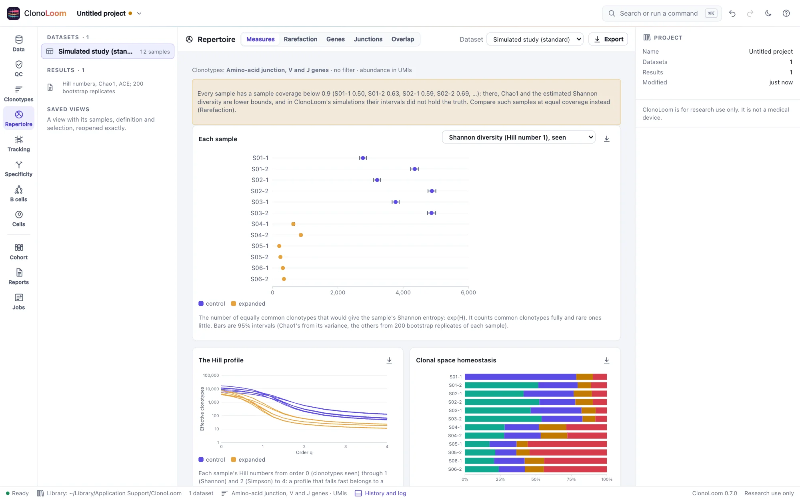
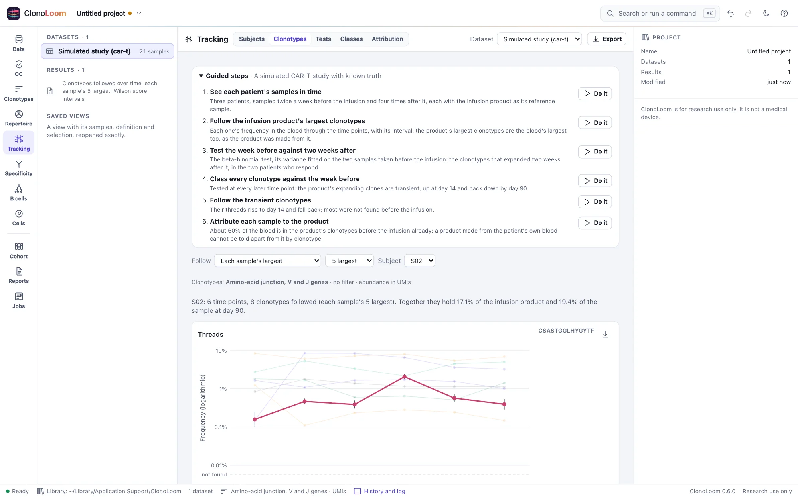
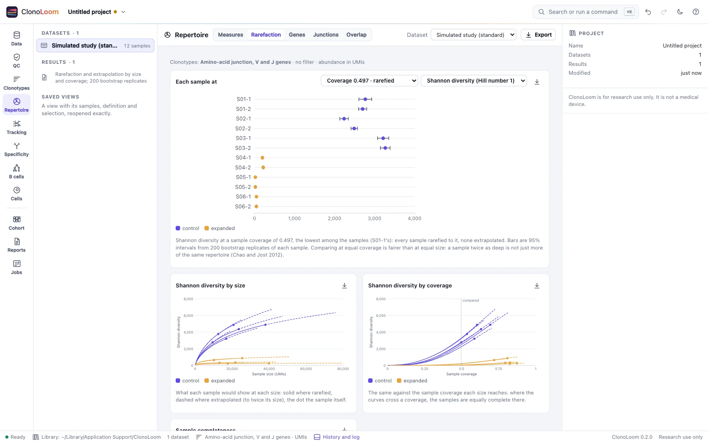
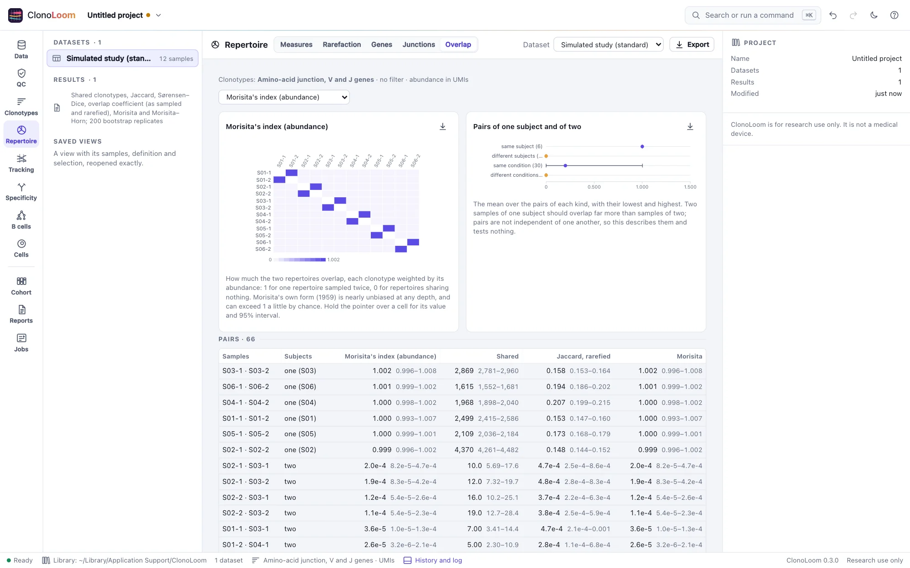
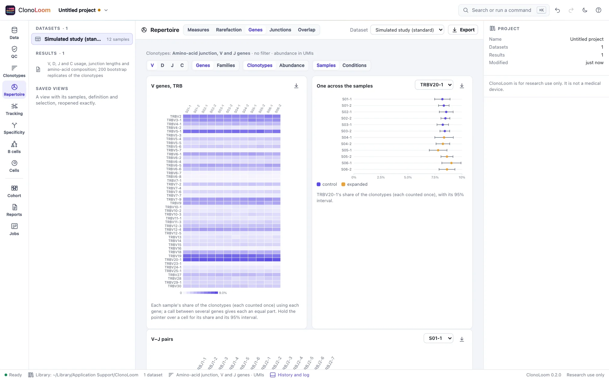
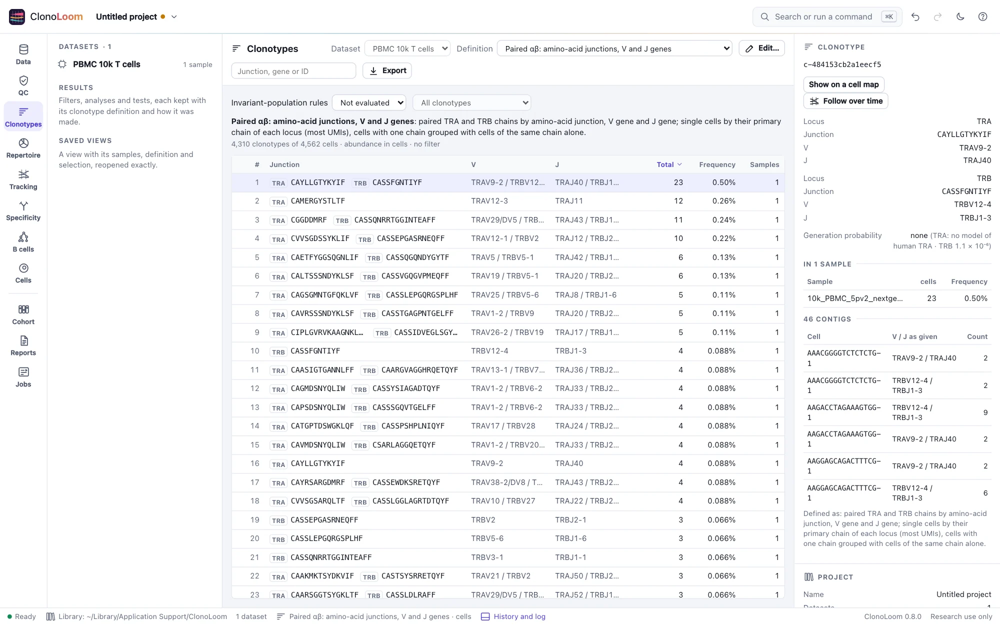
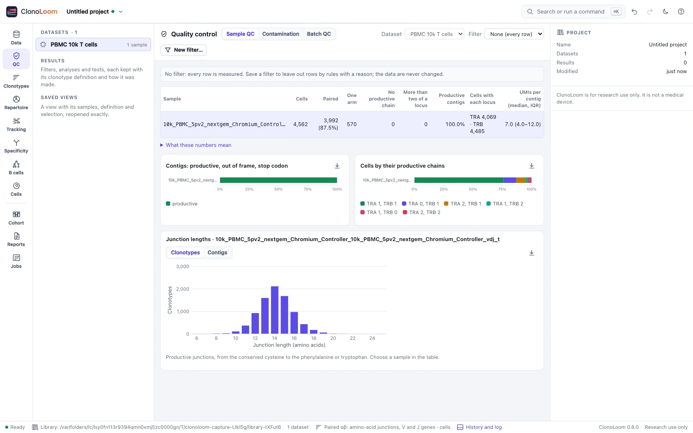
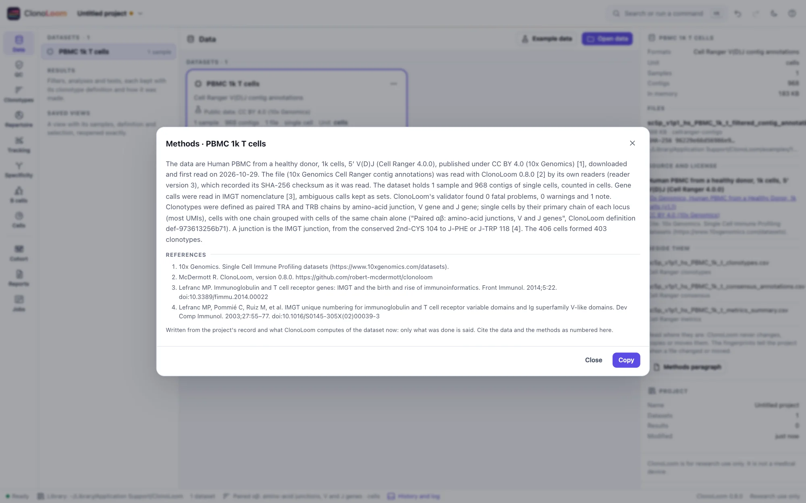

# ClonoLoom

<picture>
  <source media="(prefers-color-scheme: dark)" srcset="docs/images/diversity-dark.webp">
  
</picture>

ClonoLoom is an open-source, local-first workbench for adaptive immune receptor repertoires: T- and
B-cell receptor sequencing, bulk and single-cell. It takes the output of an annotation pipeline
(Cell Ranger, immunoSEQ, MiXCR, IgBLAST through Change-O, TRUST4, or any AIRR Community file) to
results others can check: the data validated, clonotypes defined explicitly, diversity and overlap
measured with their uncertainty, clonotypes followed over time, receptors grouped by likely
specificity, B-cell families traced, and figures, methods and certificates written, each step kept
on record.

It is one self-contained program for macOS, Linux and Windows. It opens as a desktop window, needs
no Python, R or account, and keeps your data on your computer.

**Current release:** 0.4.0 ([changelog](CHANGELOG.md), [roadmap](clonoloom-spec/roadmap.md)).
B-cell lineages, single-cell phenotypes and cohort comparisons come in later
releases.

**In development (wave 5):** B-cell Inputs retains AIRR sequence evidence, checks its
coordinates and alignments, and lets you inspect and export the supplied annotations.
IMGT/HighV-QUEST output tables can be opened together, with joined sequence evidence and
annotation provenance.
Germline reconstruction and mutation analysis are still planned.

## Features

- **Open and check your data.** AIRR Rearrangement TSV, Cell Ranger V(D)J outputs, immunoSEQ
  exports, MiXCR clone tables, OAS and OTS data units and tcrdist3 clone tables are read by
  ClonoLoom's own readers. Any other tool's CSV or TSV is read through a
  mapping of its columns, checked column by column. Each file is fingerprinted by its SHA-256. A
  validator's findings say how many rows they concern, show examples and say what to do. The
  abundance unit (cells, templates, reads, UMIs) is stated, never guessed.
- **See each sample's quality.** Productive share, clonotypes, singletons, sample coverage, the
  largest clonotype's share and gene-call resolution; for single cells, the chains of each cell.
  The vendor's own numbers are recomputed from the rows, and filters are saved as versions, each
  with its reason.
- **Define clonotypes explicitly.** Named definitions (junction, V and J levels, chains,
  single-cell rules) stated in words with every table and figure; a million clonotypes sorted and
  searched as they scroll. Published MAIT, iNKT and GEM rules flag sequence-consistent receptors
  for an explicitly chosen species, with evaluable abundance and shares per sample.
- **Measure repertoires with their uncertainty.** Hill numbers, Chao1, ACE, the estimated Shannon
  and Simpson diversity, clonality, Gini and clonal space homeostasis, each with a 95% interval.
  Rarefaction and extrapolation compare samples at equal coverage or size.
- **See what the clonotypes are made of.** V, D, J and C genes and families, V–J pairs, junction
  lengths and amino acids by IMGT position; by clonotypes or abundance, by sample or condition.
- **Compare samples.** Every pair's shared clonotypes, Jaccard, Sørensen–Dice and the overlap
  coefficient (as sampled and rarefied) and Morisita's index, with intervals; the public
  clonotypes by subject.
- **Follow clonotypes over time.** Each subject's samples placed in time from their annotation
  or metadata, checked before anything is followed; an infusion product's or each sample's largest
  clonotypes, or a list, followed through the time points as threads, alluvial plots and a table,
  each frequency with its interval, a clonotype not found shown as not found. Each clonotype tested
  between two time points by the beta-binomial test, its variance between samples fitted on
  replicate samples (or the binomial test, or Fisher's exact test), the false discovery rate
  controlled, and classed across several as emerging, transient, contracting or persistent. Each
  sample measured against its reference sample: an infusion product's clonotypes, or a donor's
  share of the blood.
- **Find receptors alike.** Every T-cell clonotype compared with every other of its chains by
  TCRdist, as tcrdist3 computes it, with the V genes' loops downloaded on request: each one's
  neighbors within a radius and its nearest, loop by loop. The neighborhoods a background does
  not explain, each radius controlled at a rate of receptors drawn from a recombination model with
  the dataset's own gene usage, with their enrichment and motif. Each clonotype's generation
  probability, how likely recombination alone is to make it, as OLGA computes it, under OLGA's
  models (downloaded on request) or ClonoLoom's own model of human TRB.
- **Match specificity evidence.** Match retained chains to VDJdb
  (downloaded on request with its terms) or the simulated vaccine database, by exact CDR3 with
  optional V/J calls or within a TCRdist radius. Inspect evidence and per-sample epitope shares,
  then follow matched clonotypes in Tracking with the source result recorded. A matching chain
  is evidence, not proof of a paired receptor's specificity.
- **Write results others can check.** Figures (SVG, PNG, PDF) whose captions state the clonotype
  definition, unit and samples; AIRR and CSV exports with a notice of each data set's license and
  citation; a methods paragraph with numbered references, written from the record. Every result is
  kept with its lineage.
- **Simulations and scripts.** `clonoloom simulate` writes studies whose truth is known, and
  programs on this computer can drive the window through remote control.

Every method is checked against an independent implementation or a known truth (the `airr`
library, pandas, scirpy, iNEXT, immunarch, vegan, tcrdist3, OLGA and simulated studies among them): see
[methods and validation](https://robert-mcdermott.github.io/clonoloom/science.html).

## A look around

<picture>
  <source media="(prefers-color-scheme: dark)" srcset="docs/images/tracking-dark.webp">
  
</picture>

Tracking: a simulated CAR-T patient's largest clonotypes through the infusion product and six
time points, the one that peaks two weeks after the infusion drawn with its intervals.

<picture>
  <source media="(prefers-color-scheme: dark)" srcset="docs/images/rarefaction-dark.webp">
  
</picture>

Rarefaction and extrapolation: the samples compared at the lowest coverage among them, and their
curves by size and by coverage.

<picture>
  <source media="(prefers-color-scheme: dark)" srcset="docs/images/overlap-dark.webp">
  
</picture>

Overlap: every pair of samples by Morisita's index, the pairs of one subject and of two
summarized, and every pair listed with its intervals.

<picture>
  <source media="(prefers-color-scheme: dark)" srcset="docs/images/genes-dark.webp">
  
</picture>

Gene usage: each sample's V genes, and one gene across the samples.

<picture>
  <source media="(prefers-color-scheme: dark)" srcset="docs/images/clonotypes-dark.webp">
  
</picture>

The Clonotypes view: 10k T cells grouped into paired αβ clonotypes, the definition stated above the
table, and the largest clonotype's chains and cells in the inspector.

<picture>
  <source media="(prefers-color-scheme: dark)" srcset="docs/images/qc-dark.webp">
  
</picture>

The QC view: cells by their productive chains, the share of productive contigs, and the
clonotypes' junction lengths.

<picture>
  <source media="(prefers-color-scheme: dark)" srcset="docs/images/methods-dark.webp">
  
</picture>

A methods paragraph, written from the project's record, with numbered references.

More screenshots, a page for every view, are in the [user guide](https://robert-mcdermott.github.io/clonoloom/docs/).

## Install

One file per platform, installed by a one-line installer that checks its checksum
([docs/INSTALLING.md](docs/INSTALLING.md)). On macOS and Linux:

```sh
curl --proto '=https' --tlsv1.2 -fsSL https://raw.githubusercontent.com/robert-mcdermott/clonoloom/main/install.sh | sh
```

On Windows, in PowerShell:

```powershell
irm https://raw.githubusercontent.com/robert-mcdermott/clonoloom/main/install.ps1 | iex
```

Or build from source with Go (the version in `go.mod` or newer): `go build -o clonoloom .`

## Getting started

```sh
clonoloom                                  # the start page
clonoloom /path/to/airr_rearrangement.tsv  # or open your own data
```

ClonoLoom opens in a desktop window: a Chromium-family browser (Chrome, Edge, Brave or Chromium)
in app mode with its own profile, or else your default browser. Name files, Cell Ranger output
folders or folders of them on the command line, or use **Open data** in the window. Data are read
where they are: ClonoLoom never copies, changes or moves them. Running `clonoloom <paths>` again
hands them to the ClonoLoom already running.

To try it without your own data, choose **Example data**: public 10x Genomics, AIRR Community and
immuneACCESS datasets, each shown with its source, size, license and citation and downloaded from
its publisher only when you ask, and simulated studies whose truth is known, made on your
computer. The [user guide](https://robert-mcdermott.github.io/clonoloom/docs/) walks through the examples and every view.

<details>
<summary>Options</summary>

| Flag | Default | What it does |
| --- | --- | --- |
| `--port` | 8860 | Preferred port; the next free one up to 8879 is used if it is taken |
| `--window` | `app` | `app` (a desktop window), `browser` (the default browser) or `none` |
| `--keep-running` | off | Keep serving after the window is closed |
| `--data-dir` | `<user config dir>/ClonoLoom` | Where the project library is kept |
| `--examples-dir` | `<data dir>/examples` | Where example data are downloaded, when asked |
| `--cache-dir` | `<user cache dir>/clonoloom` | Where tables read once are kept, to reopen datasets quickly |
| `--cache-limit` | `10GB` | The size the cache is kept within (`0`: none) |
| `--offline` | off | Download nothing: ClonoLoom then reaches no other computer |
| `--remote-control` | off | Let programs on this computer drive the window ([docs/REMOTE-CONTROL.md](docs/REMOTE-CONTROL.md)) |
| `--host` | 127.0.0.1 | Interface to bind |
| `--dev` | off | Serve `web/` from the working directory (development) |
| `--version` | | Print `clonoloom X.Y.Z` and exit |

</details>

## Command-line tools

- `clonoloom simulate --out <new folder>` writes a simulated TRB study whose truth is known: AIRR
  rearrangement tables, their Repertoire metadata, and the truth beside them; presets `standard`,
  `null` and `small`, and the CAR-T, transplant and vaccination studies over time.
  Wave 5 adds `--preset bcell-immunization`: artificial paired heavy/light chains with known
  families, ancestors, mutation events, isotypes and sampled cells, also offered offline in
  Example data. See [simulated studies](docs/SIMULATION.md) for each model and its limits.

It takes `-h` for its settings.

## Documentation

- [The website](https://robert-mcdermott.github.io/clonoloom/): the user guide, installing, and the methods with their validation
  ([docs/site/](docs/site/README.md) builds it).
- [Installing](docs/INSTALLING.md): release files, installers, upgrading, uninstalling.
- [Formats](docs/FORMATS.md): what each reader reads and how.
- [Remote control](docs/REMOTE-CONTROL.md): driving ClonoLoom from scripts.
- [Simulated studies](docs/SIMULATION.md): `clonoloom simulate`, its model and its truth.
- [Requirements](clonoloom-spec/requirements.md): what ClonoLoom must do.
- [Design](clonoloom-spec/design.md): how it is built and why.
- [Roadmap](clonoloom-spec/roadmap.md): the order of the work, wave by wave (wave *N* is release
  0.*N*.0).
- [Research](clonoloom-spec/research.md): the methods, formats and datasets behind it, with
  citations.
- [Conventions](clonoloom-spec/conventions.md): code, science and terminology rules.

## Development

```sh
go test -race ./...                      # the Go program
node --test "web/lib/**/*.test.mjs"      # the browser modules
node validation/run.mjs                  # checks against references (validation/README.md)
go run . --dev --window none             # serve web/ from disk at http://127.0.0.1:8860
node docs/capture/capture.mjs            # the documentation's pictures (docs/images)
node docs/site/build.mjs /tmp/site       # the website, every link checked (docs/site/README.md)
```

The web app is plain ES modules with no build step and no dependencies. CI tests each commit
once. A release is a tag (`v0.4.0`) whose files CI has passed on; the release workflow builds the
six binaries and drafts the release.

## Example data

The public example datasets are downloaded from their publishers only when asked; they are not
part of ClonoLoom or this repository:
- 10x Genomics' single-cell V(D)J runs, under [CC BY 4.0](https://creativecommons.org/licenses/by/4.0/);
- the AIRR Community's test files, under CC BY 4.0;
- three subjects of Emerson et al. 2017 from immuneACCESS, under its terms of use (research only,
  no redistribution), which you accept in the window before they are downloaded.

The simulated studies are made by ClonoLoom on your computer when asked. The screenshots in this
documentation show 10x Genomics' Human PBMC 1k (v1.1) and 10k PBMC (5′ v2.0) datasets and the
standard simulated study.

## Siblings

ClonoLoom is the fifth of a family of local-first research workbenches that share their design,
security model and conventions: [Proteoscope](https://github.com/robert-mcdermott/proteoscope)
(protein structures), [CytoWeave](https://github.com/robert-mcdermott/cytoweave) (cytometry),
[MaveScape](https://github.com/robert-mcdermott/mavescape) (multiplexed assays of variant effect)
and [SituCraft](https://github.com/robert-mcdermott/situcraft) (spatial transcriptomics).

## Research use

ClonoLoom is for research use only. It is not a medical device and makes no diagnostic claims.

## License

[Apache License 2.0](LICENSE). See [NOTICE](NOTICE).
