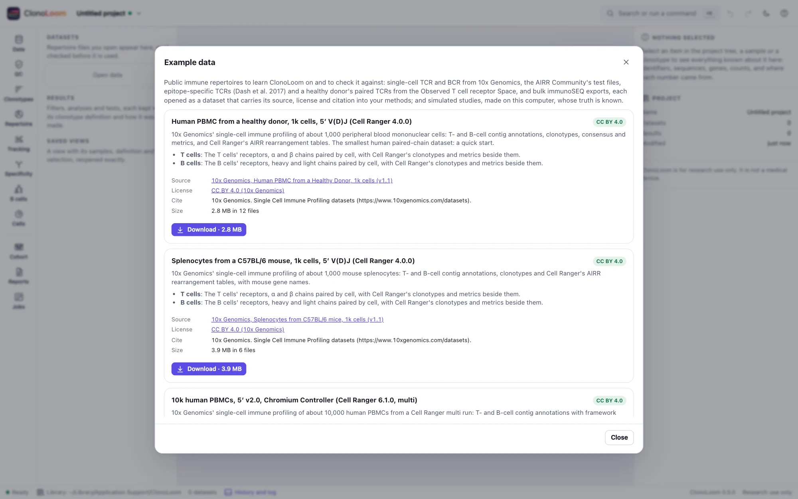
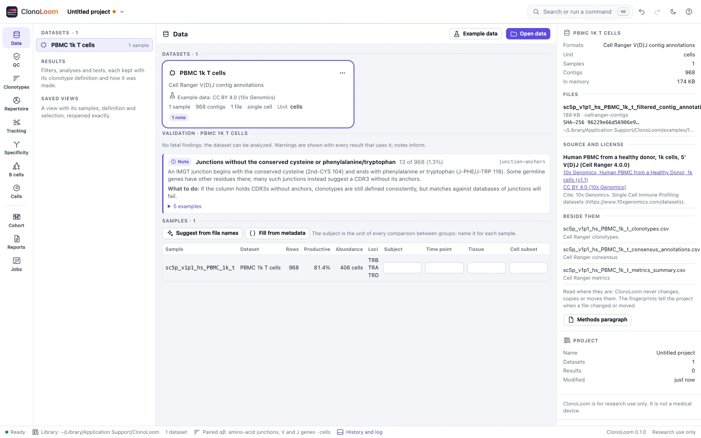

# Getting started

A first study in ClonoLoom 0.1.0: open data, check them, look at each sample's quality, define
clonotypes, and write down what was done. It takes a few minutes with the example data, and works
the same way with your own.

## Start ClonoLoom

```sh
clonoloom
```

ClonoLoom opens in its own window (or your default browser, with `--window browser`) on the start
page. It runs on your computer only: nothing is uploaded, and it reaches no other computer unless
you ask it to download example data (`--offline` stops even that). Stop it by closing the window,
or with Ctrl+C in the terminal that started it. The flags are in the [README](../README.md#getting-started).

## Open data

<picture>
  <source media="(prefers-color-scheme: dark)" srcset="images/examples-dark.webp">
  
</picture>

- **Your own data.** **Open data** shows the folders of this computer: choose AIRR rearrangement
  tables, a Cell Ranger V(D)J output folder (a `vdj` run, its `outs/`, or a `multi` run's
  per-sample folders), immunoSEQ exports, or a folder holding a cohort's files. What you choose
  together opens as **one dataset**: a cohort's exports, say, or a run's T cells. You can also
  name the files on the command line (`clonoloom run1/outs`). ClonoLoom reads each file where it
  is and never changes, copies or moves it. Files dropped on the window are copied into the
  library instead, since a browser does not say where a dropped file lies.
- **Example data.** **Example data** lists public datasets: 10x Genomics' single-cell runs of human
  PBMCs and mouse splenocytes, the AIRR Community's test files, and three subjects of Emerson et
  al. 2017 in immunoSEQ's format. Each shows its source, size, license and citation before you
  download it. Data under a provider's terms of use (the immuneACCESS data) need you to read and
  accept the terms first. Every file is checked against the checksum recorded when ClonoLoom was
  released. **Open T cells** (or B cells) then opens it as a dataset, which carries its license
  and citation from then on.

To follow along, download **Human PBMC from a healthy donor, 1k cells** (2.8 MB) and open its
T cells.

## Check the data

<picture>
  <source media="(prefers-color-scheme: dark)" srcset="images/data-dark.webp">
  
</picture>

The **Data** view shows each dataset of the project:

- **The card**: its format, rows, samples, whether it is single-cell or bulk, and its **unit**:
  cells, templates, reads or UMIs. When the files do not say whether reads or molecules were
  counted (an AIRR file with `duplicate_count` alone), ClonoLoom does not guess: choose the unit,
  and until you do, results say "counts".
- **Validation**: each finding with its severity, how many rows it concerns, examples (file, line,
  value) and what to do. A **fatal** finding stops analysis; a **warning** is shown with every
  result that uses the dataset; a **note** informs. Each has a stable code
  (`junction-anchors`, `locus-mismatch`, …) you can cite.
- **Samples**: rows, productive share, abundance and loci, and the annotation that later waves
  compare by: subject, time point, tissue, cell subset, condition, batch, HLA. **Suggest from file
  names** and **Fill from metadata** (AIRR Repertoire metadata, immunoSEQ's sample tags) propose
  values; each keeps where it came from.
- **The inspector** (right): the files with their SHA-256 fingerprints, what was read beside them
  (Cell Ranger's clonotypes and metrics), and the data's source and license.

If a file later moves, **Locate the files** finds it again by its fingerprint near where it was,
or lets you choose it and checks it. If a file's contents change, the project says so instead of
reading other data under the same name.

## Look at quality

<picture>
  <source media="(prefers-color-scheme: dark)" srcset="images/qc-dark.webp">
  
</picture>

**QC** measures every sample, every number computed by ClonoLoom from the rows:

- bulk samples: abundance, the productive, out-of-frame and stop-codon shares, clonotypes,
  singletons, **sample coverage** (Chao and Jost 2012, as iNEXT computes it), the
  largest clonotype's share, how often V and J calls name one gene, and reads per template or UMI;
- single cells: cells by their productive chains (a pair, one arm, none, more than two of a
  locus), cells with each locus, UMIs per contig;
- **the vendor's numbers, recomputed**: Cell Ranger's metrics summary and immunoSEQ's sample
  columns, each beside the number ClonoLoom counts from the rows, with whether they agree.

**What these numbers mean** explains each in plain words.

To leave rows out, make a **filter**: **New filter…**, choose its rules (productive only, a
minimum count, loci, cells only, high-confidence contigs, at most so many chains of a locus in a
cell, samples left out), and say why. A filter is never deleted: editing it saves a new version,
and the rows each rule leaves out are counted. The dataset's analyses use the version you choose;
the data themselves are never changed.

## Define clonotypes

<picture>
  <source media="(prefers-color-scheme: dark)" srcset="images/clonotypes-dark.webp">
  
</picture>

A clonotype is whatever the definition says it is, so ClonoLoom makes you choose one and states it
everywhere clonotypes are counted (also in the status bar):

- **Presets**: the amino-acid junction with V and J genes (the default for bulk data), the
  nucleotide junction with V and J genes, the amino-acid junction alone, paired αβ chains, paired
  heavy and light chains (the defaults for single cells), or the source's own clonotypes (Cell
  Ranger's, an AIRR file's `clone_id`).
- **Edit…** to choose the junction (nucleotide or amino acid), V and J at allele, gene or family
  level or not at all, which chains, and for single cells whether a cell's primary chain of each
  locus or every chain counts, and what to do with cells missing a chain. Save it under a name to
  use it for the project's other datasets.

Each clonotype has an ID made from the definition and its chains, the same in every run. Sort by
any column, search by junction, gene or ID, and choose a clonotype to see its chains, its
abundance in each sample and the contigs or rearrangements it is made of.

## Write down what was done

<picture>
  <source media="(prefers-color-scheme: dark)" srcset="images/methods-dark.webp">
  
</picture>

- **The project** saves itself to the library as you work; **Open a saved project** (⇧⌘O) lists
  them. Undo and redo cover every change.
- **History and log** (the status bar, or ⌘J) lists what was done to the project, and the
  session's messages.
- **Methods paragraph** (a dataset's menu or the inspector) writes a paragraph for a manuscript
  from the project's record: the data's source and license, how ClonoLoom read and checked them,
  the unit, the filter with what it kept, the clonotype definition, and ClonoLoom's version, with
  numbered references. Only what was done is said. **Copy** takes it with its references.

## Next

ClonoLoom grows release by release ([roadmap](../clonoloom-spec/roadmap.md)): diversity with its
uncertainty, rarefaction and overlap, figures and AIRR exports come in 0.2.0; following
clonotypes over time in 0.3.0; specificity, B-cell lineages, cells and cohorts after that.
