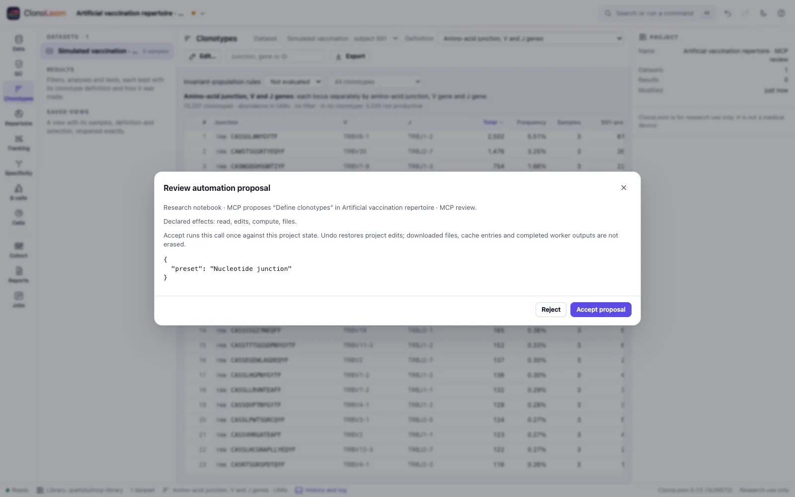

# MCP: the local research window

Wave 8 development, slice 7. Published 0.7.0 binaries predate this transport. The application
version remains 0.7.0; action API 2, catalog 3 and automation policy 1 are independent versions.

## Connect a client

Configure your MCP client to start the development executable with argument arrays:

```json
{
  "mcpServers": {
    "clonoloom": {
      "command": "/absolute/path/to/clonoloom",
      "args": ["mcp", "--data-dir", "/absolute/path/to/mcp-library"]
    }
  }
}
```

This common configuration shape is client-specific, not part of MCP. Use an absolute executable
and a dedicated library directory, with one host per library. ClonoLoom starts its normal local
host and opens its window lazily on the first permitted tool call. `tools/list` and discovery
need no window. Default access is read-only (`get_state`). For a workflow that opens local data,
computes tables and proposes project changes, add `"--allow", "edits,compute,files"` to `args`.
Add `network` only for workflows needing example/reference downloads; `--offline` still blocks
those downloads. Restart the process to change grants.

`--window none` leaves window opening to you; the local address is printed to stderr. A tool
waits up to 40 seconds for a connected window. Normal app/browser modes attempt opening at most
once every 20 seconds while waiting. The most recently connected window receives calls. Do not
supply positional input files: use the reviewed `open_data` tool. MCP requires a numeric loopback
host and does not attach to or elevate the permissions of an existing process. A best-effort
live-host check refuses a known live host using the same directory; it is not an interprocess
lock and cannot detect every concurrent launch or non-remote host on another port.

As in CytoWeave and MaveScape, this is a stdio subprocess hosting the normal local application.
It is not a network MCP endpoint. stdout contains only newline-delimited JSON-RPC; diagnostics,
help, version and the local address go to stderr. Closing stdin cancels pending calls and stops
the owned host, removing its connection file. Interrupt/termination also requests shutdown.
Worker shutdown remains cooperative; closing a window alone does not terminate the MCP process.

## Protocol versions

The implementation follows the official [2026-07-28 versioning rules](https://modelcontextprotocol.io/specification/2026-07-28/basic/versioning),
[stdio transport](https://modelcontextprotocol.io/specification/2026-07-28/basic/transports/stdio)
and [tools contract](https://modelcontextprotocol.io/specification/2026-07-28/server/tools),
checked on 2026-10-28. It supports two explicit modes:

| Mode | Start | Request identity |
| --- | --- | --- |
| 2026-07-28 | `server/discover`; no initialization handshake | Each request supplies its own protocol version and client capabilities in `_meta`; optional client info never inherits another request's identity |
| 2025-11-25 | `initialize`, then `notifications/initialized` | The initialized client label is used only for legacy requests without modern protocol metadata |

Modern example (send as one line):

```json
{"jsonrpc":"2.0","id":"state-1","method":"tools/call","params":{"name":"get_state","arguments":{},"_meta":{"io.modelcontextprotocol/protocolVersion":"2026-07-28","io.modelcontextprotocol/clientCapabilities":{},"io.modelcontextprotocol/clientInfo":{"name":"Research notebook","version":"1"}}}}
```

Missing modern metadata gives `-32602`; an unsupported per-request version gives `-32022`
with supported/requested versions. Modern results include `resultType: "complete"` and server
info; discovery and tool lists have private, zero-duration cache scope. Bad modern metadata
never falls back to an earlier client's identity. Legacy initialization negotiates 2025-11-25
(the client must stop if it cannot support the returned version), following the
[legacy lifecycle](https://modelcontextprotocol.io/specification/2025-11-25/basic/lifecycle).
Other handshake revisions are not claimed as supported. `ping` is available in both modes.

Only tools are advertised. There are no resources, prompts, sampling, elicitation, subscriptions,
tasks or server-initiated requests. A tool execution failure is `isError: true`; malformed calls
and unknown tools use protocol errors. The catalog fits one page; omit `cursor`.

## Permissions and review

`tools/list` derives from the shared action catalog and includes only actions whose complete
conservative effect set is granted. Calling a hidden action by name still fails. Each tool's
`_meta["org.clonoloom/automation"]` records effects, review, API, catalog and policy versions.
These describe the host policy; client capability metadata does not grant application effects.

The stdio process uses its launch grants without passing a token in every tool argument. Its
HTTP endpoint still requires the local token for non-read calls. Both transports share argument
validation, grants, window dispatch and the last-500-event session audit. Caller names are
self-reported labels, not authenticated identities. This is not an operating-system sandbox.

An edit proposes exact arguments against the current project. A person accepts or rejects it
in the window. No MCP tool can accept proposals. Stale proposals, existing jobs/imports and
cancelled callers are refused under the same [automation policy](AUTOMATION.md). Accepted edits
record the caller in History and use normal Undo/Redo. Provider acknowledgements remain separate.



The example uses simulated vaccination repertoires from one subject at three observations. It
shows a proposed definition change, not evidence for a biological treatment effect. Query
filtering changes membership and displayed rank; it preserves original abundance and the full
clonotype-table denominator under the current definition and QC rules.

## Results, progress and cancellation

A successful call contains the same `{ok, message, data}` envelope as HTTP, serialized in a text
content block and in `structuredContent`. The transport never parses native numeric tokens
through a floating-point map. `query_clonotypes` also retains native JSON in `data.resultJSON`.
Consumers must use a precision-preserving JSON decoder for exact integers/decimal tokens;
JavaScript `JSON.parse` alone cannot represent all such values. Native certificate bytes remain
the authority for exact replay, not reserialized client objects.

Optional `params._meta.progressToken` requests a heartbeat every five seconds. Its increasing
number measures elapsed seconds waiting for the window, review or action, not percent complete
or a scientific worker's progress. Tokens must be unique among active calls. See official
[progress](https://modelcontextprotocol.io/specification/2026-07-28/basic/patterns/progress).

Send `notifications/cancelled` with `params.requestId` to cancel. After processing cancellation,
the server emits no more results/progress for that request (already-written messages may still
arrive). EOF cancels all pending calls. The window receives cancellation and refuses later
attachments; existing files/artifacts/downloaded bytes can remain. There is no automatic retry,
rollback or deletion. Reinspect state and History before submitting again. See official
[cancellation](https://modelcontextprotocol.io/specification/2026-07-28/basic/patterns/cancellation).

| Bound | Behavior |
| --- | --- |
| 2 MiB incoming frame, 1 MiB action arguments | Refuse; drain oversized lines so later messages remain readable |
| 16 active calls | Refuse excess calls; the shared window dispatcher executes one at a time |
| 65,536 request IDs per process | Stop at the limit; reconnect with a new process |
| String IDs/tokens at most 512 encoded bytes, or integers within ±(2^53−1) | Reject null/fractional/unsafe IDs; IDs cannot be reused in a session |
| 16 MiB outgoing tool response, including both content representations | Explicit `output-too-large` error; no truncated success; request fewer rows or native exports |
| 40-second window wait; 10-minute window action timeout | Explicit failure; capability and argument refusals happen before opening a window |

Dependent edits must wait for the preceding result; concurrent call order is unspecified.
Tool names are limited to 128 bytes. Batches are unsupported. Duplicate JSON keys and invalid UTF-8 are refused. Output writes are
serialized; write failures end the transport. File-backed stdout uses a ten-second write deadline
where the OS supports it. A response-size failure can occur after the action completed; do not
blindly retry. These bounds are ClonoLoom implementation choices, not scientific thresholds.

## Scientific boundary

MCP adds no estimator, embedding, plot, tolerance or scientific replay kind. It invokes the same
Go methods and reviewed project operations as HTTP and the application. Definition, QC, units,
denominators, seeds and provenance retain their existing meanings. The five supported exact
certificate replay kinds and their captured-input limits remain unchanged; see
[Certificates](CERTIFICATES.md). Protocol success, explicit permission and successful replay do
not establish biological validity, model calibration or receptor specificity.
